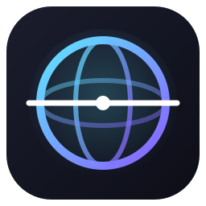

<p align="center">
  
</p>

<h1 align="center">osv360</h1>

<p align="center">
  Convert DJI Osmo 360 <code>.OSV</code> recordings into stabilized, editable 8K equirectangular 360° video.<br>
  GPU stitching · IMU horizon lock · hardware encoding · desktop app + CLI for Linux, Windows and macOS
</p>

<p align="center"></p>

---

The DJI Osmo 360 records `.OSV` files: two separate 3840×3840 fisheye videos plus
proprietary metadata. Editors such as **Kdenlive** or **FilmCraft** can't open them
as 360° video, and DJI's own software is not available on Linux. **osv360** turns
them into standard **HEVC 10-bit equirectangular MP4** files with 360° metadata and
the original audio.

## Features

- **Seamless stitching.** Reads each camera's factory lens calibration from the file and refines it per clip from the footage itself. Seam misalignment is about 2 px at 8K.
- **Horizon lock** from the camera's built-in 1 kHz IMU. Roll and pitch are removed completely while the view smoothly follows your direction of travel. Full direction lock, all-axis smoothing and off are also available.
- **Exposure and colour matching** between the two lenses.
- **GPU accelerated.** Hardware decode → GPU compute stitch (wgpu: Vulkan, Metal or Direct3D 12) → hardware HEVC encode (VA-API, NVENC, AMF, Quick Sync or VideoToolbox). An 8K50 clip converts at about 15 fps on a Radeon 890M laptop iGPU.
- **Desktop app.** Drag & drop a batch of files and convert them with one click. It shows the camera's thumbnails, progress, ETA, cancel, notifications and persistent settings.
- **CLI** for scripting, with the same options plus single-frame previews.
- **Editor-friendly output.** `hvc1` HEVC Main10, BT.709 tags, 0.5 s keyframe interval, Spherical Video V1 + V2 metadata (recognised by YouTube, VLC, Kdenlive and others).
- Reads the `.OSV` in place: no gigabytes of intermediate files.

## Platforms

| | Package | Hardware decode / encode | Status |
|---|---|---|---|
| **Linux** x86-64 | `.AppImage` | VA-API (AMD, Intel), NVENC | developed and tested here |
| **Windows** 10/11 x64 | `.zip` | D3D11VA / NVENC, AMF, Quick Sync | experimental: built by CI, not yet tested on real hardware |
| **macOS** 12+ Apple Silicon | `.dmg` | VideoToolbox | experimental: built by CI, not yet tested on real hardware |

If no hardware HEVC encoder works, osv360 falls back to the CPU encoder (x265). It's correct, just several times slower.

## Requirements

- **A GPU** with Vulkan (Linux, Windows), Direct3D 12 (Windows) or Metal (macOS) for the stitching.
- **ffmpeg** ≥ 6, installed separately:
  - Linux: your package manager (`sudo pacman -S ffmpeg`, `sudo apt install ffmpeg`, `sudo dnf install ffmpeg`);
  - macOS: `brew install ffmpeg`;
  - Windows: `winget install Gyan.FFmpeg`, or put `ffmpeg.exe` and `ffprobe.exe` in an `ffmpeg` folder next to `osv360.exe`.
- About 6 GB of free disk space per 2-minute clip at default quality.

Check your system with `osv360 doctor` (or look at the status chip in the app).

## Install

Download the package for your system from the [Releases page](https://github.com/toccifrancesco/osv-slayer/releases).

**Linux:** make the AppImage executable and run it:
```bash
chmod +x osv360-*-x86_64.AppImage
./osv360-*-x86_64.AppImage                          # opens the app
./osv360-*-x86_64.AppImage convert CAM_0001.OSV     # the same file works as CLI
```

**Windows:** unzip anywhere, then start `osv360.exe`. The app isn't code-signed, so SmartScreen may warn: choose *More info → Run anyway*.
For the command line use `osv360-cli.exe`.

**macOS:** open the `.dmg` and drag *osv360* into *Applications*. The app isn't notarized, so on first launch right-click it → *Open* → *Open*.
If macOS says it is "damaged", run `xattr -dr com.apple.quarantine /Applications/osv360.app`.
For the command line use `/Applications/osv360.app/Contents/MacOS/osv360-cli`.

**From source** (any OS, with [uv](https://docs.astral.sh/uv/)):
```bash
git clone https://github.com/toccifrancesco/osv-slayer.git && cd osv-slayer
uv sync --extra gui
uv run osv360                 # app
uv run osv360 --help          # CLI
```

## Using the app

1. Drop `.OSV` files or whole folders (e.g. the camera's `DCIM` folder) onto the window, or use **Add files / Add folder**.
2. Pick the output folder in the bottom bar, and adjust **⚙ Settings** if needed.
3. Press **▶ Convert**. Files are processed one after another. **■ Stop** cancels the current file cleanly (no half-written outputs), and you can resume later.

The first conversion of each clip spends about a minute calibrating the lenses. The result is cached.

### Settings

| Tab | Setting | Default | Notes |
|---|---|---|---|
| Output | Output folder / next to source | `~/Videos/osv360` | |
| | File name | `{name}_{mode}` | placeholders `{name}`, `{mode}`, `{codec}` |
| | Overwrite, open folder when done, notification | off / off / on | |
| Stabilization | Mode | Horizon lock + smooth heading | also: full lock, smooth all axes, off |
| | Heading smoothing | 1.0 s | higher = lazier turns |
| | Rotation smoothing | 0.5 s | for *smooth all axes* |
| Quality | Codec | HEVC 10-bit (GPU) | ProRes 422 (large, intra-frame), x265 (CPU, slow) |
| | Quality | High (QP 27, ≈400 Mbit/s) | Maximum 22 · High 27 · Balanced 30 · Compact 33 |
| | Resolution | 8K 7680×3840 | 6K, 4K |
| | Keyframe interval | 25 frames | shorter = faster scrubbing |
| Advanced | Seam blend width | 6° | |
| | Lens exposure matching | on | |
| | Rolling-shutter readout | 0 ms (off) | experimental |
| | HEVC encoder | Automatic | force VA-API / NVENC / AMF / Quick Sync / VideoToolbox / CPU |
| | Recalibrate | off | ignore the cached lens calibration |

Settings are stored in the usual place for your OS (Linux: `~/.config/osv360/osv360.conf`). Set `OSV360_CONFIG=/path/file.ini` to use a different file (portable mode).

## Using the CLI

```bash
osv360 info CAM_0001.OSV                                  # metadata, calibration, IMU
osv360 convert CAM_0001.OSV CAM_0002.OSV --output-dir out # batch
osv360 convert CAM_0001.OSV -o clip.mp4 --stabilize lock --qp 30 --scale 0.5
osv360 convert CAM_0001.OSV --start 30 --duration 5 -o test.mp4   # quick test
osv360 still CAM_0001.OSV --time 12.5 -o frame.png         # one stitched frame
osv360 doctor                                             # check ffmpeg / VA-API / GPU
```

`osv360 convert --help` lists all options (they mirror the settings above). `--progress-json` prints machine-readable progress events.

## Editing tips

- **Kdenlive:**
  - enable *proxy clips* for smooth 8K timelines;
  - reframe a flat 16:9 shot with the *Equirectangular to Rectilinear* effect;
  - hide the helmet or mount with *Equirectangular Cap*.
- **FilmCraft** decodes HEVC Main10 with VA-API and offers VR effects for equirectangular footage.
- If you need an intra-frame edit copy, convert with the ProRes codec. Expect about 10× larger files.
- Colour is passed through as recorded. If you shot in D-Log M, apply DJI's LUT in your editor.

## Troubleshooting

- **"No GPU" in the app / `gpu None` in `osv360 doctor`**: check that a Vulkan driver is installed (e.g. `vulkan-radeon`, `vulkan-intel` or the NVIDIA driver). Run `VK_LOADER_DEBUG=error osv360 doctor` to see why the driver did not load.
- **"ffmpeg not found"**: install ffmpeg (see *Requirements*) or set `OSV360_FFMPEG_DIR` to the folder that contains it.
- **Slow conversion / "CPU encoding"**: no hardware HEVC encoder works on this machine. `osv360 doctor` shows which one was picked.

## Limitations

- Objects within about 1 m of the camera (your hand, a helmet, the mount) cannot line up perfectly at the seam, because the two lenses see them from slightly different positions. DJI's own stitch shows the same.
- Only the Osmo 360's `dvtm_oq101` metadata has been tested.
- Rolling-shutter correction is experimental and off by default.
- The AppImage is built on Ubuntu 22.04 and needs glibc 2.35 or newer (Ubuntu 22.04+, Debian 12+, Fedora 36+, Arch).
- Windows and macOS builds are not code-signed or notarized (see *Install*), and macOS builds target Apple Silicon only.

## How it works

The short version: the `.OSV` container is parsed directly to read the lens calibration and the 1 kHz attitude quaternions. Both lenses are decoded in hardware, then a single Vulkan compute pass maps every output pixel through the stabilizing rotation into both fisheye images and blends them. The result is encoded in hardware. Details, measurements and the reverse-engineered metadata layout are in [docs/HOW_IT_WORKS.md](docs/HOW_IT_WORKS.md).
Development, tests and building the AppImage are covered in [docs/DEVELOPMENT.md](docs/DEVELOPMENT.md).

## License

osv360 is released under the [MIT](LICENSE) license.

The downloadable packages also contain third-party open-source software: Qt/PySide6 (LGPL-3.0), NumPy, SciPy, OpenCV, wgpu, Python and others. Their licenses and notices are in `THIRD_PARTY_LICENSES.txt` inside each package, and in the app under *Settings → About*. ffmpeg isn't bundled.

Not affiliated with or endorsed by DJI. "DJI" and "Osmo" are trademarks of their respective owner.
