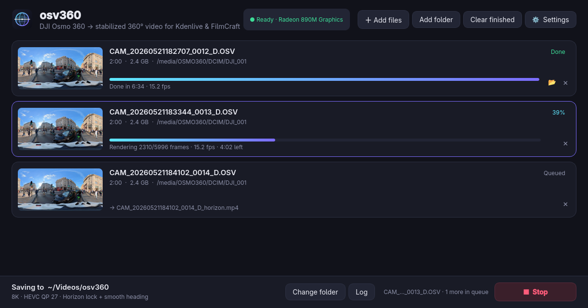

<p align="center">
  
</p>

<h1 align="center">osv360</h1>

<p align="center">
  Convert DJI Osmo 360 <code>.OSV</code> recordings into stabilized, editable 8K equirectangular 360° video.<br>
  GPU stitching · IMU horizon lock · VA-API hardware encoding · Linux desktop app + CLI
</p>

<p align="center"></p>

---

The DJI Osmo 360 records `.OSV` files: two separate 3840×3840 fisheye videos plus
proprietary metadata. Editors such as **Kdenlive** or **FilmCraft** can't open them
as 360° video, and DJI's own software is not available on Linux. **osv360** turns
them into standard **HEVC 10-bit equirectangular MP4** files with 360° metadata and
the original audio.

## Features

- **Seamless stitching.** Reads each camera's factory lens calibration from the file and refines it per clip from the footage itself. Seam misalignment is about 2 px at 8K.
- **Horizon lock** from the camera's built-in 1 kHz IMU. Roll and pitch are removed completely while the view smoothly follows your direction of travel. Full direction lock, all-axis smoothing and off are also available.
- **Exposure and colour matching** between the two lenses.
- **GPU accelerated.** Hardware decode (VA-API) → Vulkan compute stitch (wgpu) → hardware HEVC encode (VA-API). An 8K50 clip converts at about 15 fps on a Radeon 890M laptop iGPU.
- **Desktop app.** Drag & drop a batch of files and convert them with one click. It shows the camera's thumbnails, progress, ETA, cancel, notifications and persistent settings.
- **CLI** for scripting, with the same options plus single-frame previews.
- **Editor-friendly output.** `hvc1` HEVC Main10, BT.709 tags, 0.5 s keyframe interval, Spherical Video V1 + V2 metadata (recognised by YouTube, VLC, Kdenlive and others).
- Reads the `.OSV` in place: no gigabytes of intermediate files.

## Requirements

- Linux x86-64 with a **Vulkan** GPU driver (Mesa RADV/ANV, or NVIDIA).
- **ffmpeg** ≥ 6 in `PATH`, with `hevc_vaapi` for hardware encoding (the default on Arch, Fedora, Ubuntu).
  Without VA-API you can still pick the ProRes or x265 codec.
- About 6 GB of free disk space per 2-minute clip at default quality.

Check your system with `osv360 doctor` (or look at the status chip in the app).

## Install

### AppImage
Download `osv360-<version>-x86_64.AppImage`, make it executable and run it:

```bash
chmod +x osv360-*-x86_64.AppImage
./osv360-*-x86_64.AppImage            # opens the app
./osv360-*-x86_64.AppImage convert CAM_0001.OSV   # same binary works as CLI
```

### From source (with [uv](https://docs.astral.sh/uv/))
```bash
git clone <this repo> osv360 && cd osv360
uv sync --extra gui
.venv/bin/osv360                 # app
.venv/bin/osv360 --help          # CLI
```

## Using the app

1. Drop `.OSV` files or whole folders (e.g. the camera's `DCIM` folder) onto the window, or use **Add files / Add folder**.
2. Pick the output folder in the bottom bar, and adjust **⚙ Settings** if needed.
3. Press **▶ Convert**. Files are processed one after another. **■ Stop** cancels the current file cleanly (no half-written outputs), and you can resume later.

The first conversion of each clip spends about a minute calibrating the lenses. The result is cached.

### Settings

| Tab | Setting | Default | Notes |
|---|---|---|---|
| Output | Output folder / next to source | `~/Videos/osv360` | |
| | File name | `{name}_{mode}` | placeholders `{name}`, `{mode}`, `{codec}` |
| | Overwrite, open folder when done, notification | off / off / on | |
| Stabilization | Mode | Horizon lock + smooth heading | also: full lock, smooth all axes, off |
| | Heading smoothing | 1.0 s | higher = lazier turns |
| | Rotation smoothing | 0.5 s | for *smooth all axes* |
| Quality | Codec | HEVC 10-bit (GPU) | ProRes 422 (large, intra-frame), x265 (CPU, slow) |
| | Quality | High (QP 27, ≈400 Mbit/s) | Maximum 22 · High 27 · Balanced 30 · Compact 33 |
| | Resolution | 8K 7680×3840 | 6K, 4K |
| | Keyframe interval | 25 frames | shorter = faster scrubbing |
| Advanced | Seam blend width | 6° | |
| | Lens exposure matching | on | |
| | Rolling-shutter readout | 0 ms (off) | experimental |
| | Recalibrate | off | ignore the cached lens calibration |

Settings are stored in `~/.config/osv360/osv360.conf`. Set `OSV360_CONFIG=/path/file.ini` to use a different file (portable mode).

## Using the CLI

```bash
osv360 info CAM_0001.OSV                                  # metadata, calibration, IMU
osv360 convert CAM_0001.OSV CAM_0002.OSV --output-dir out # batch
osv360 convert CAM_0001.OSV -o clip.mp4 --stabilize lock --qp 30 --scale 0.5
osv360 convert CAM_0001.OSV --start 30 --duration 5 -o test.mp4   # quick test
osv360 still CAM_0001.OSV --time 12.5 -o frame.png         # one stitched frame
osv360 doctor                                             # check ffmpeg / VA-API / GPU
```

`osv360 convert --help` lists all options (they mirror the settings above). `--progress-json` prints machine-readable progress events.

## Editing tips

- **Kdenlive:**
  - enable *proxy clips* for smooth 8K timelines;
  - reframe a flat 16:9 shot with the *Equirectangular to Rectilinear* effect;
  - hide the helmet or mount with *Equirectangular Cap*.
- **FilmCraft** decodes HEVC Main10 with VA-API and offers VR effects for equirectangular footage.
- If you need an intra-frame edit copy, convert with the ProRes codec. Expect about 10× larger files.
- Colour is passed through as recorded. If you shot in D-Log M, apply DJI's LUT in your editor.

## Limitations

- Objects within about 1 m of the camera (your hand, a helmet, the mount) cannot line up perfectly at the seam, because the two lenses see them from slightly different positions. DJI's own stitch shows the same.
- Only the Osmo 360's `dvtm_oq101` metadata has been tested.
- Rolling-shutter correction is experimental and off by default.
- The AppImage is built on a current distribution, so very old systems (older glibc) may need to run from source.

## How it works

The short version: the `.OSV` container is parsed directly to read the lens calibration and the 1 kHz attitude quaternions. Both lenses are decoded in hardware, then a single Vulkan compute pass maps every output pixel through the stabilizing rotation into both fisheye images and blends them. The result is encoded in hardware. Details, measurements and the reverse-engineered metadata layout are in [docs/HOW_IT_WORKS.md](docs/HOW_IT_WORKS.md).
Development, tests and building the AppImage are covered in [docs/DEVELOPMENT.md](docs/DEVELOPMENT.md).

## License

[MIT](LICENSE). Not affiliated with or endorsed by DJI. "DJI" and "Osmo" are trademarks of their respective owner.
